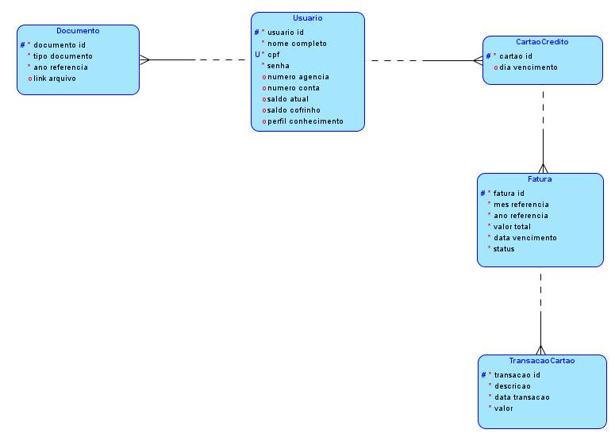
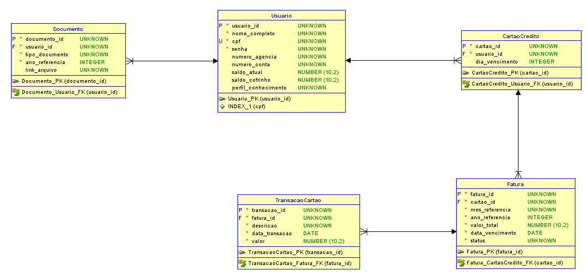
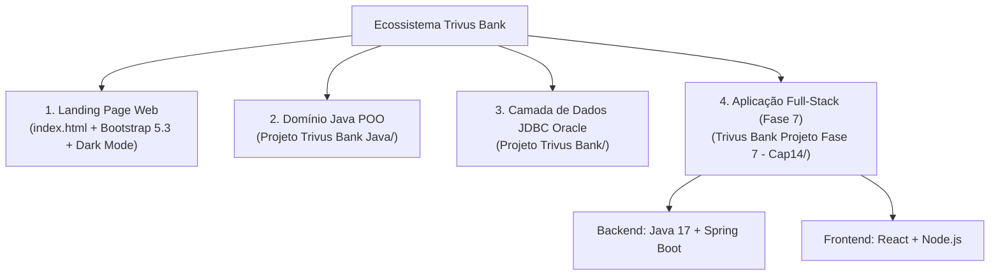

# Trivus Bank — Ecossistema Fintech Educativo & Acessível

<p align="center">
  
</p>


**Autor:** Renan Santa Rosa Xavier — RM566997

---

## Sobre o Projeto

O **Trivus Bank** é uma Fintech e banco digital educativo criado ao longo das fases do curso de Análise e Desenvolvimento de Sistemas (FIAP). Seu nome vem de **"Três Virtudes": Segurança, Simplicidade e Transparência**, com foco especial na inclusão digital de idosos e pessoas com dificuldade em aplicativos bancários tradicionais.


---

## Vitrine Visual da Plataforma (Landing Page & Experiência do Usuário)

| Problema: Complexidade para Idosos | Solução: App Simples e Acessível |
| :---: | :---: |
|  |  |

| Educação Financeira e Perfil | Assistente com Inteligência Artificial |
| :---: | :---: |
|  |  |

---

## Modelagem de Banco de Dados (MER Lógico e Físico)

| Modelo Lógico Relacional | Modelo Físico Oracle SQL |
| :---: | :---: |
|  |  |

---

## Arquitetura dos 4 Módulos do Repositório



### 1. Landing Page Interativa ([`index.html`](index.html) e [`Assets/`](Assets))
- **Tecnologias:** HTML5, CSS3, Bootstrap 5.3, JavaScript (Dark Mode nativo) e vídeo de background.
- **Destaques de Acessibilidade:** Tipografia ampliada em 50%, alto contraste (`#00563F` / `#00cf87`), carrossel explicativo de 6 etapas e responsividade mobile.

### 2. Domínio Orientado a Objetos em Java ([`Projeto Trivus Bank Java/`](Projeto%20Trivus%20Bank%20Java))
- Implementação de herança, polimorfismo e encapsulamento para as entidades centrais da Fintech: `Conta`, `ContaCorrente`, `CartaoCredito`, `TransferenciaPix`, `UsuarioFintech` e `TesteFintech`.

### 3. Persistência e DAO com Oracle JDBC ([`Projeto Trivus Bank/`](Projeto%20Trivus%20Bank) e [`Sql proj trivus bank.sql`](Sql%20proj%20trivus%20bank.sql))
- Projeto Maven integrado ao driver oficial `ojdbc8` da Oracle para operações de banco de dados das tabelas financeiras.

### 4. Aplicação Full-Stack — Spring Boot + React ([`Trivus Bank Projeto Fase 7 - Cap14/`](Trivus%20Bank%20Projeto%20Fase%207%20-%20Cap14))
- **Backend (`backend/`):** API REST em Java 17 + Spring Boot gerenciando Usuários, Categorias e Transações financeiras (`http://localhost:8080`).
- **Frontend (`frontend/`):** Interface SPA em React consumindo a API em tempo real.

---

## Como Executar

### Landing Page
Abra o arquivo [`index.html`](index.html) diretamente no navegador.

### Aplicação Full-Stack (Fase 7)
```bash
# 1. Iniciar o Backend (Spring Boot)
cd "Trivus Bank Projeto Fase 7 - Cap14/backend"
mvn spring-boot:run

# 2. Iniciar o Frontend (React)
cd "Trivus Bank Projeto Fase 7 - Cap14/frontend"
npm install
npm start
```
